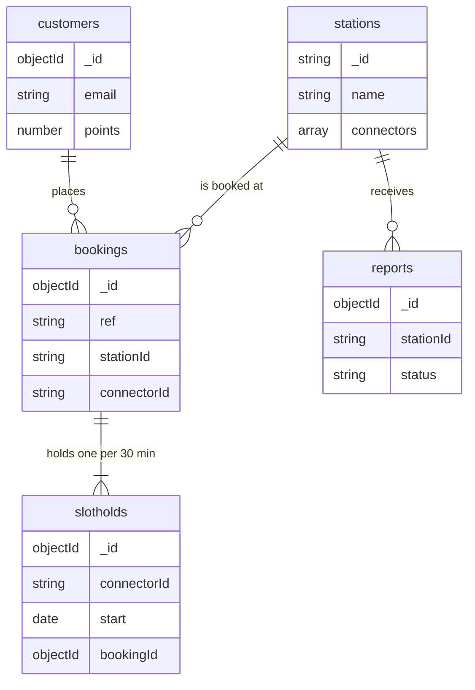

# Database Schema

WattSpot stores its data in **MongoDB Atlas** (database `wattspot`) through Mongoose. There are five collections. Each one is defined in `server/models/`.

## How the collections connect

- A **station** is one charging site. Its plugs (called **connectors**) are stored inside the station document, not in a separate collection.
- A **booking** is one reservation of one plug. It keeps a copy of the station and plug details as they were when the driver booked.
- A booking holds one **slothold** for every 30-minute slot of its charge. The slot holds are what stop two drivers booking the same plug at the same time.
- A **customer** is found by email, and is created on their first booking. Bookings link to customers by email.
- A **report** is about one station.

Links between collections are plain ids stored as text (`stationId`, `connectorId`) or as a MongoDB id (`bookingId`). Customers are matched by `email`.

## stations

One document per charging site, with its plugs inside it.

| Field | Type | Notes |
|-------|------|-------|
| `_id` | String | Readable id, such as `up-town-center` |
| `name` | String | Required |
| `address` | String | Required |
| `area` | String | Required, such as `Diliman` |
| `location` | Object | GeoJSON point: `type` is `Point`, `coordinates` is `[lng, lat]` |
| `openHour` | Number | 0 to 23, Manila time. `0` with a `closeHour` of 24 means open 24/7. |
| `closeHour` | Number | 1 to 24 |
| `description` | String | Defaults to empty |
| `pricePerKwhCents` | Number | Price per kWh in centavos. `0` means free charging. |
| `connectors` | Array | At least one. See below. |

Each item in `connectors` (one physical plug, so one car at a time):

| Field | Type | Notes |
|-------|------|-------|
| `connectorId` | String | Required, such as `UPTC-DC1`. Unique across all stations. |
| `label` | String | Required, such as `CCS2 DC #1` |
| `type` | String | `CCS2`, `Type2` or `CHAdeMO` |
| `kw` | Number | Charger output, at least 1 |

Indexes: `location` (2dsphere, for "nearby stations") and `connectors.connectorId` (unique).

## bookings

One document per reservation. Every amount is worked out by the server (`server/pricing.js`).

| Field | Type | Notes |
|-------|------|-------|
| `_id` | ObjectId | The booking id used in URLs |
| `ref` | String | Unique reference shown to the driver, such as `WS-7F3K2Q` |
| `stationId` | String | Links to `stations._id` |
| `stationName` | String | Copied from the station |
| `connectorId` | String | The plug that was booked |
| `connectorLabel`, `connectorType`, `connectorKw` | String, String, Number | Plug details copied at booking time |
| `customer.name` | String | Required |
| `customer.email` | String | Required, saved in lowercase |
| `paymentMethod` | String | `GCash`, `Maya Wallet`, `Card` or `Watt Credits` |
| `vehicle.model` | String | Required |
| `vehicle.batteryKwh` | Number | Battery size |
| `vehicle.maxKw` | Number | The car's top charging speed |
| `startPct` | Number | Battery now, 0 to 99 |
| `targetPct` | Number | Charge to, 1 to 100 |
| `kwh` | Number | Energy to add: battery × (target − start) |
| `chargeKw` | Number | The lower of the plug's kW and the car's kW |
| `slotStart` | Date | Start of the booking, UTC |
| `slotEnd` | Date | End of the booking, UTC |
| `slotCount` | Number | How many 30-minute slots, at least 1 |
| `chargingMinutes` | Number | Estimated charging time |
| `pricePerKwhCents` | Number | Price used for this booking |
| `chargingCents` | Number | kWh × price |
| `reservationFeeCents` | Number | ₱50 (5000) |
| `depositCents` | Number | Refundable, ₱100 (10000) |
| `totalCents` | Number | Charging + fee + deposit |
| `revenueCents` | Number | Total minus the deposit |
| `pointsEarned` | Number | Watt Credits earned |
| `pointsRedeemed` | Number | Watt Credits spent |
| `offPeak` | Boolean | True if the charge starts between 10 PM and 6 AM |
| `status` | String | `confirmed` or `cancelled`. Defaults to `confirmed`. No route cancels a booking yet. |
| `createdAt` | Date | Defaults to now |

Indexes: `ref` (unique), `createdAt` (newest first) and `stationId` + `status`.

## slotholds

One document for every 30-minute slot a booking holds on a plug. A 70-minute charge starting at 14:00 holds three slots: 14:00, 14:30 and 15:00.

| Field | Type | Notes |
|-------|------|-------|
| `_id` | ObjectId | |
| `stationId` | String | Required |
| `connectorId` | String | Required. The plug that is held. |
| `start` | Date | Required. The slot's start (UTC), always on :00 or :30. |
| `date` | String | Required. The Manila date, `YYYY-MM-DD`. Only for reading in Atlas. |
| `bookingId` | ObjectId | Required. Links to `bookings._id`. |

Indexes: **`connectorId` + `start` is unique**, and `start`.

The unique index is what makes double-booking impossible. If two drivers, or one double-click, try to hold the same slot, MongoDB rejects the second insert. The whole booking is undone and the route answers **409** with later open times.

## customers

One document per email address. Created automatically on a customer's first booking.

| Field | Type | Notes |
|-------|------|-------|
| `_id` | ObjectId | |
| `email` | String | Required, unique, saved in lowercase |
| `name` | String | Required. Updated at each booking. |
| `points` | Number | Watt Credits balance. Defaults to 0, never below 0. |
| `createdAt` | Date | Defaults to now |

## reports

One document per incident report.

| Field | Type | Notes |
|-------|------|-------|
| `_id` | ObjectId | The report id used in URLs |
| `stationId` | String | Required. Links to `stations._id`. |
| `stationName` | String | Copied from the station |
| `issueType` | String | `Broken charger`, `Socket blocked`, `Payment problem`, `Station closed` or `Other` |
| `description` | String | 10 to 500 characters |
| `reporterName` | String | Defaults to empty |
| `reporterEmail` | String | Defaults to empty |
| `status` | String | `open` or `resolved`. Defaults to `open`. |
| `createdAt` | Date | Defaults to now |
| `resolvedAt` | Date | `null` until the report is resolved |

Index: `createdAt` (newest first).

## Notes

- **Money** is stored in centavos (whole numbers), so ₱26 is `2600`. The API converts to pesos.
- **Dates and times** are stored in UTC. Opening hours and slot times are worked out in Manila time (UTC+8).
- **Free sockets right now** (`stock` in the API) is calculated from the slot holds that cover the current moment. It is never stored.
- **Transactions:** saving a booking inserts the booking, inserts its slot holds and updates the customer's Watt Credits in one transaction. This is why `MONGODB_URI` must point at a replica set (Atlas is one).
- **Sample data:** `npm run seed` loads 10 Quezon City stations with 28 plugs. `npm run seed -- --reset` also deletes all bookings, slot holds, customers and reports.
