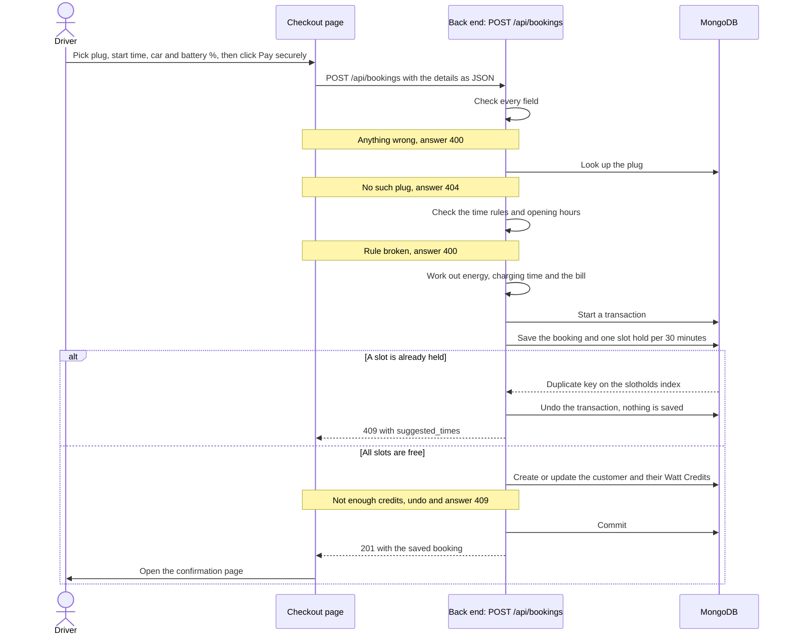

# System Diagram

## The three layers

```mermaid
flowchart LR
    subgraph FE["Front end (browser)"]
        A1["front end - max: home, directory, map search, station page"]
        A2["frontend-map: live Mapbox station map"]
        A3["shop and checkout: cart, pay, confirmation"]
        A4["owner: dashboard and report form"]
    end

    subgraph BE["Back end (Node.js + Express 5, one Render service)"]
        B1["server.js"]
        B2["server/routes: stations, bookings, metrics, reports"]
        B3["server/repositories: reads and writes"]
        B4["server/models: Mongoose collections"]
    end

    DB[("MongoDB Atlas: stations, bookings, slotholds, customers, reports")]

    FE -->|"HTTP requests with JSON, /api/..."| B1
    B1 --> B2
    B2 --> B3
    B3 --> B4
    B4 -->|"Mongoose"| DB
```

| Layer | Folders and files | Job |
|-------|-------------------|-----|
| Front end | `front end - max/`, `frontend-map/`, `shop/`, `checkout/`, `owner/` | The pages drivers and the owner see. They call the API with `fetch`. The same Express service serves these pages, so there is no CORS. |
| Back end | `server.js`, `server/routes/`, `server/repositories/`, `server/models/` | Checks every request (`validate.js`), works out time and prices (`pricing.js`), applies the business rules (`config.js`) and talks to the database. |
| Database | MongoDB Atlas, through `server/db.js` | Stores stations, bookings, slot holds, customers and reports. |

Which page uses which route:

| Page | Routes it calls |
|------|-----------------|
| Home, directory, map search (`front end - max`) | `GET /api/stations` |
| Station page (`front end - max/station`) | `GET /api/stations/:id`, `GET /api/stations/:id/availability` |
| Live map (`frontend-map`) | `GET /api/stations` |
| Cart (`shop`) and checkout (`checkout`) | `POST /api/bookings/quote`, `POST /api/bookings` |
| Confirmation (`checkout`) | `GET /api/bookings/:id` |
| Owner dashboard (`owner`) | `GET /api/metrics`, `GET /api/bookings`, `GET /api/reports`, `PATCH /api/reports/:id/resolve` |
| Report an issue (`owner`) | `GET /api/products`, `POST /api/reports` |

## Placing a booking, step by step

1. The driver picks a plug, an open start time, their car and battery % (now and target), then a payment method on the checkout page, and clicks **Pay securely**. Before this, the cart and checkout pages call `POST /api/bookings/quote` so the price they show comes from the server.
2. The page sends `POST /api/bookings` with the details as JSON.
3. The back end checks every field again (it never trusts the browser). If anything is wrong it answers **400**.
4. It looks up the plug. If it does not exist it answers **404**.
5. It checks the time rules: not in the past, within 7 days, on the hour or half hour, and inside opening hours. If one fails it answers **400**.
6. It works out the energy, charging time, number of 30-minute slots and the bill itself. Any total sent by the browser is ignored.
7. It starts a transaction and saves the booking together with one slot hold for each 30-minute slot of the charge.
8. If another booking already holds one of those slots, MongoDB refuses the duplicate (the unique `connectorId` + `start` index). The transaction is undone and the page gets a **409** with up to 4 later open times.
9. Otherwise it creates the customer on their first booking, or updates their Watt Credits. If they pay with credits and have too few, the transaction is undone and the answer is **409**.
10. It commits. All of it is saved together or not at all. The answer is **201** with the saved booking, and the page opens `confirmation.html?id=...`, which reads the booking back with `GET /api/bookings/:id`.
