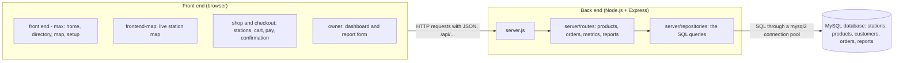
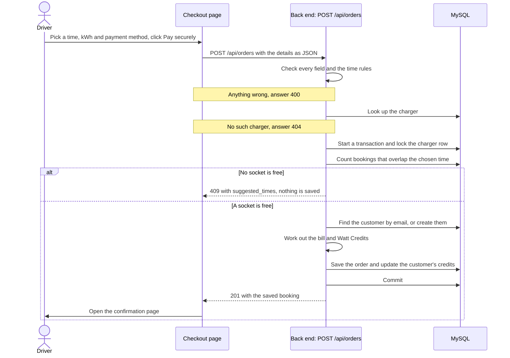

# System Diagram

## The three layers

| Layer | Folders and files | Job |
|-------|-------------------|-----|
| Front end | `front end - max/`, `frontend-map/`, `shop/`, `checkout/`, `owner/` | The pages drivers and the owner see. They call the API with `fetch`. |
| Back end | `server.js`, `server/routes/`, `server/repositories/` | Checks every request, applies the business rules (`server/config.js`), works out bills, and talks to the database. |
| Database | MySQL (`server/db.js`) | Stores stations, chargers, customers, bookings and reports. |

Which page uses which route:

| Page | Routes it calls |
|------|-----------------|
| Home, directory (`front end - max`) | `GET /api/products` |
| Map (`frontend-map`) | `GET /api/stations` |
| Stations, station detail, cart (`shop`) | `GET /api/products`, `GET /api/products/:id` |
| Checkout (`checkout`) | `GET /api/products/:id`, `POST /api/orders` |
| Confirmation (`checkout`) | `GET /api/orders/:id` |
| Owner dashboard (`owner`) | `GET /api/metrics`, `GET /api/orders`, `GET /api/reports`, `PATCH /api/reports/:id/resolve` |
| Report an issue (`owner`) | `GET /api/products`, `POST /api/reports` |

## Placing a booking, step by step

1. The driver chooses a start time, how many kWh they want and a payment method on the checkout page, then clicks **Pay securely**.
2. The page sends `POST /api/orders` with the details as JSON.
3. The back end checks every field again (it never trusts the browser) and the time rules: not in the past, within 7 days, on the hour or half hour, and inside opening hours. If anything is wrong it answers **400**.
4. It looks up the charger. If it does not exist it answers **404**.
5. It starts a transaction and locks that charger's row, so two drivers cannot take the last socket at the same moment.
6. It counts the saved bookings that overlap the chosen time. If every socket is taken it answers **409** with up to 4 later open times, and saves nothing.
7. It finds the customer by email, or creates a new one.
8. It works out the bill itself: charging cost + ₱50 reservation fee + ₱100 refundable deposit, plus the Watt Credits earned or spent. If the customer is paying with Watt Credits and has too few, it answers **409**.
9. It saves the order, updates the customer's Watt Credits and commits. All of this is saved together or not at all.
10. It answers **201** with the saved booking, and the page opens `confirmation.html?id=...`.
