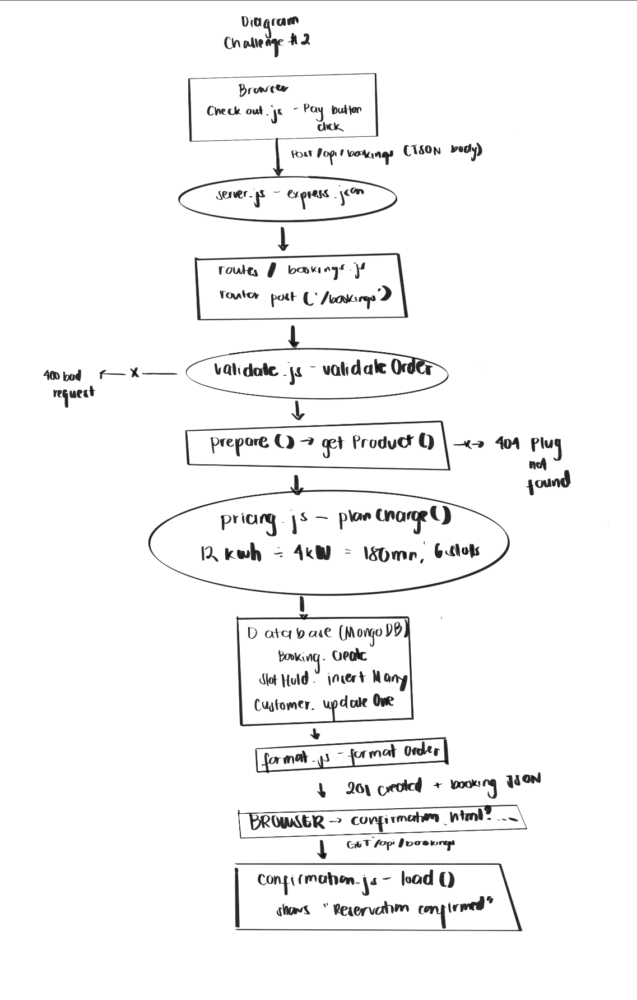

# Challenges

## Challenge 1: Break your own API

Collection: [postman/challenge1.postman_collection.json](postman/challenge1.postman_collection.json)

| # | Request | It should answer | We got | Proof |
|---|---|---|---|---|
| 0 | Valid booking on plug `CWH-DC1` (takes the slot for #3) | 201 | 201 Created, ref `WS-78TGGM` | [screenshot](Challenge1screenshots/1794836399105_image.png) |
| 1 | Booking with battery now `start_pct: -5` | 400 | 400 Bad Request, `start_pct` error | [screenshot](Challenge1screenshots/1794836418946_image.png) |
| 2 | Booking that sends `"total": 1` | Saved with the server's total, or 400 | 201 Created, saved with the server's total | [screenshot](Challenge1screenshots/1794836442693_image.png) |
| 3 | Same booking as #0 (slot taken) | 409 | 409 Conflict | [screenshot](Challenge1screenshots/1794836458547_image.png) |
| 4 | `GET /api/stations/does-not-exist` | 404 | 404 Not Found | [screenshot](Challenge1screenshots/1794836477290_image.png) |
| 5 | Booking without `customer_email` | 400 | 400 Bad Request, `customer_email` error | [screenshot](Challenge1screenshots/1794836494150_image.png) |
| 6 | `GET /api/stations?q=zzzz` | 200 with an empty list | 200 OK, `[]` | [screenshot](Challenge1screenshots/1794836507180_image.png) |

## Challenge 2: Trace one real request

- Request payload: [c2-payload.png](Challenge2screenshots/c2-payload.png)
- Request headers: [c2-headers.png](Challenge2screenshots/c2-headers.png)
- Response: [c2-response.png](Challenge2screenshots/c2-response.png)
- Read-back: [c2-readback.png](Challenge2screenshots/c2-readback.png)
- Read-back headers: [c2-readback-headers.png](Challenge2screenshots/c2-readback-headers.png)

## Challenge 3: Overrule the AI

**1. Using the Node terminal instead of an allowed tool (Challenge 5)**  
The AI suggested a recording script where I'd run chargingWindow directly in the Node terminal (require('./server/pricing')) with two test predictions. When I double-checked Section 8 of the GC2 spec, I caught two issues: the terminal isn't on the list of allowed tools (it requires the Console, Network tab, Postman, or a database viewer), and the rubric asks for three predictions plus changing one input or line of code. Instead of recording the terminal script, I ran the function through POST /api/bookings/quote in Postman and wrote out three predictions—along with changing the target from 70% to 71%—in docs/challenges.md before hitting record.

**2. Git checkout blocked by local lockfile changes**  
To test Mav's MongoDB branch locally, the AI told me to run git switch g4/m1-mongodb-switch. Git blocked it immediately because running npm install on main had modified package-lock.json and node_modules/.package-lock.json, and untracked .env.example and docs/ files were also in the way. I discarded the lockfile diffs with git restore package-lock.json node_modules/.package-lock.json, moved the untracked files out of the folder temporarily, and then switched branches. (Good reminder to always check git status first.)

**3. Outdated Postman routes from the old MySQL backend**  
The AI generated a Postman collection targeting /api/orders and /api/products, which were leftover endpoints from our old MySQL setup. Since migrating to MongoDB, those routes changed to /api/bookings and /api/stations, so running the old collection would have just thrown 404s. I rebuilt the collection for the MongoDB endpoints and checked each Challenge 1 request directly against the route files in server/routes/ before running anything.

## Challenge 4: The owner changes a rule

For this challenge we picked the 50 pesos reservation fee, since it is our version of the free-shipping line. Imagine if the owner told us to change it, and we looked everywhere this fee would appear. 

We found one main area. The sever/config.js line 19, RESERVATION_FEE_CENTS: 5000. This is the real rule, the server uses it to work out all the prices, and the cart checkout and confirmation pages show the finished product of what the server sends back. If we had only changed config.js file, customers would pay the new fee while the home page and the Eastwood Mall page still said 50 pesos.